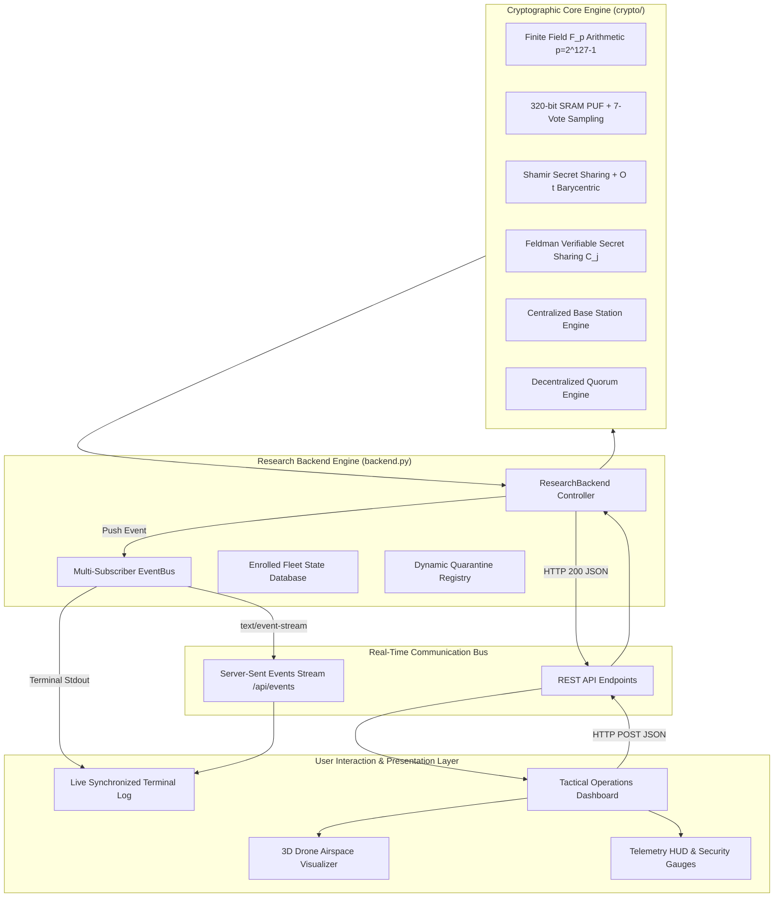
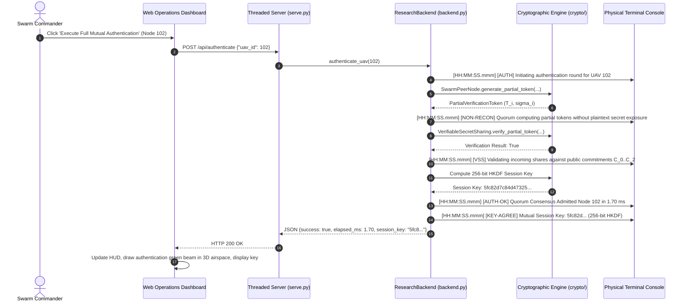

# ARCHITECTURE.md
## System Architecture & Live Operational Pipeline Specification

**Project:** Autonomous UAV Swarm Mutual Authentication & State-Ratcheted Key Agreement  
**Group:** Group 24 (Deepak Kag, Y Sri Harsha Raju, K Hemanth)  
**System Architecture Paradigm:** Hybrid Dual-Topology (Centralized Base Station & Decentralized Peer Quorum)  
**Integration Stack:** Python 3.12 Asynchronous Backend + Multi-Threaded HTTP/SSE Server + Vanilla ES2022 Tactical Web Dashboard  

---

### 1. High-Level Architectural Model

The platform is architectured to provide zero-trust mutual authentication, physical unclonable hardware identity verification, and dynamic forward-secure session key agreement for tactical UAV fleets.



---

### 2. Dual-Topology Operational Modes

The architecture supports dynamic runtime switching between two operational topologies via a configuration toggle:

#### Mode A: Centralized Base Station (Bansal & Sikdar 2024 Baseline)
* **Application Scope:** Line-of-sight base camp operations with an active command tower.
* **Master Entity:** `CentralizedBaseStation` maintains the enrolled challenge-response database, generates 3-pass mutual challenges ($C, L, N_B$), verifies applicant MACs, and issues session confirmation.
* **Vulnerability Mitigated:** Overcomes eavesdropping and replay attacks via high-entropy nonces ($N_A, N_B$) and SHA-256 HMAC integrity tags.

#### Mode B: Decentralized Autonomous Peer Quorum (Three-Phase Upgrade)
* **Application Scope:** Deep-field, contested tactical environments beyond base-station radio horizon.
* **Master Entity:** `DecentralizedQuorumCoordinator` orchestrates a local peer group of $K \ge t$ active swarm nodes.
* **Phase 1 (Decentralized Admission):** Distributed challenge generation without central infrastructure.
* **Phase 2 (Non-Reconstructive Aggregation):** Quorum nodes calculate partial tokens $\sigma_i = y_i \cdot w_i \pmod p$ and $T_i = g^{\sigma_i} \pmod P$. The master secret $S$ is never assembled in plaintext memory at any node.
* **Phase 3 (Feldman VSS Verification):** Quorum verifies each token $T_i$ against coefficient commitments $C_0, \dots, C_{t-1}$. Poisoned shares are detected and quarantined before admission decisions are finalized.

---

### 3. UI - Backend - Terminal Synchronization Pipeline

A core requirement of this platform is that **every user interaction triggers real algorithm execution and produces synchronized terminal logging**. There are no dummy buttons, mocked timers, or fabricated responses.



#### Terminal Log Format Specification
All backend events conform to a strict, parseable format:
```
[HH:MM:SS.mmm] [SUBSYSTEM] Specific algorithmic event description
```
Valid subsystems:
- `[SETUP]`: Initialization of Mersenne prime field and polynomial commitments.
- `[READY]`: Fleet bootstrap and quorum provisioning confirmation.
- `[API]`: Inbound HTTP request parsing and parameter validation.
- `[AUTH]`: Handshake pass execution and nonce verification.
- `[QUORUM]`: Peer quorum consensus formation and voting.
- `[NON-RECON]`: Homomorphic partial-token calculation ($\sigma_i = y_i \cdot w_i$).
- `[VSS]`: Feldman commitment verification against $g^{a_j} \pmod P$.
- `[QUARANTINE]`: Identification and isolation of malicious or noisy shares.
- `[KEY-AGREE]`: HKDF-SHA256 session key agreement output.
- `[ATTACK]`: Injection of adversarial test vectors.
- `[DEFENSE]`: Cryptographic interception and mitigation log.
- `[BENCHMARK]`: Genuine CPU microsecond execution measurements.

---

### 4. Threat Model & Security Boundaries

The system is evaluated under the standard **Dolev-Yao Threat Model** augmented with physical hardware compromise scenarios:

| Threat Vector | Adversary Capability | Defense Mechanism | Code Verification |
|---|---|---|---|
| **Eavesdropping (Sniffing)** | Attacker captures all transit frames $M_1, M_2, M_3$. | Shares $y_i$ masked with PUF responses ($L_i = y_i \oplus R_i$). Nonces prevent replay. | Mode A & Mode B |
| **Replay Attack** | Attacker replays captured valid $M_1$ frame. | `NonceCache` detects duplicate $N_A$ within window; session aborts immediately. | `test_replay_defense` |
| **Man-in-the-Middle (MitM)** | Attacker flips bits in transit frames. | HMAC-SHA256 with key $H(S)$ fails verification; connection terminated. | `test_mitm_defense` |
| **Cloned / Rogue UAV** | Attacker extracts software code and runs on another drone. | SRAM PUF biometric unique to silicon hardware; incorrect $R_j$ yields corrupted shares. | `test_cloned_puf_defense` |
| **Coordinator Capture** | Attacker physically captures admission leader drone. | Phase 2 Non-Reconstructive aggregation ensures master secret $S$ is never in RAM. | `test_non_reconstructive` |
| **Share Poisoning** | Byzantine / compromised peer injects fake shares. | Phase 3 Feldman VSS verifies $g^{y_i} \equiv \prod C_j^{x_i^j} \pmod P$; node quarantined. | `test_poisoned_share` |
| **Environmental Noise** | High thermal or voltage drift causes PUF bit errors. | 7-sample majority voting + $(t, k)$ polynomial error correction tolerates $\le k-t$ faults. | `test_fault_tolerance` |

---

### 5. Data Flow & State Management

1. **Bootstrap State:**
   - Generated during system startup in `backend.py`.
   - Polynomial coefficients $a_0 = S, a_1, \dots, a_{t-1} \in \mathbb{F}_p$.
   - Public Feldman commitments $C_j = g^{a_j} \pmod P$ stored in memory and shared with all fleet nodes.
2. **Node Provisioning:**
   - UAV enrolled with unique seed, OTP ID, and share $y_i = f(x_i) \pmod p$.
   - UAV independently verifies its own share against $C_j$ before accepting it.
3. **Session Ratcheting:**
   - Each successful authentication triggers one-way forward ratcheting:
     $$\text{State}_{n+1} = \text{HMAC-SHA256}(\text{State}_n, K_{\text{sess}})$$
   - Guarantees backward and forward secrecy across mission life.
