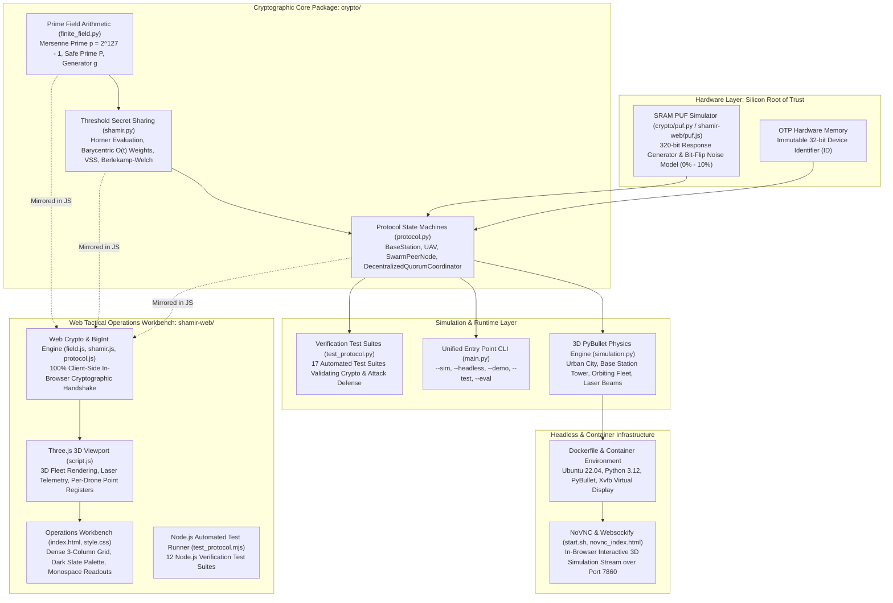

# UAV Swarm Autonomous Authentication Platform - Architecture Specification

## 1. System Overview

The platform provides a production-grade, zero-trust mutual authentication and state-ratcheted key agreement system for autonomous unmanned aerial vehicle (UAV) swarms. The architecture eliminates single points of failure, single points of compromise, and poisoning attacks through a three-phase progression from centralized base-station authentication to verifiable, non-reconstructive decentralized quorum consensus.

---

## 2. Platform Architecture Diagram



---

## 3. Component Breakdown & Responsibilities

### 3.1 Cryptographic Core Engine (`crypto/`)

| Module | Primary Responsibilities | Key Mathematical Primitives |
|---|---|---|
| [`crypto/finite_field.py`](file:///c:/Users/deepak%20kag/OneDrive/Desktop/addition%20project/crypto/finite_field.py) | Field arithmetic over $\mathbb{F}_p$ ($p = 2^{127}-1$) and commitment group $\mathbb{Z}_P^*$; deterministic response-to-coordinate mapping; HKDF-SHA256 session key derivation; constant-time byte XOR operations. | `mod_inverse()` (Extended Euclidean Algorithm), `field_add()`, `field_mul()`, `hash_to_field()`, `hkdf_derive_session_key()` |
| [`crypto/shamir.py`](file:///c:/Users/deepak%20kag/OneDrive/Desktop/addition%20project/crypto/shamir.py) | Polynomial representation and Horner evaluation; $O(t)$ barycentric Lagrange interpolation at $x=0$; Verifiable Secret Sharing (VSS) public commitment generator and validator; non-reconstructive partial verification tokens; Berlekamp-Welch Reed-Solomon decoder; combinatorial $t$-subset recovery. | `Polynomial`, `BarycentricInterpolator`, `VerifiableSecretSharing`, `berlekamp_welch_decode()`, `recover_secret_noisy()` |
| [`crypto/puf.py`](file:///c:/Users/deepak%20kag/OneDrive/Desktop/addition%20project/crypto/puf.py) | Hardware Root-of-Trust simulator. Generates 320-bit (40 bytes) cryptographic responses per challenge; stochastic bit-flip error model; environmental presets (Ideal 0%, Normal 2%, Hot 5%, Aged 10%); temporal majority voting across sequential reads. | `SRAMPUF`, `evaluate()`, `evaluate_set()`, `set_environment_preset()` |
| [`crypto/protocol.py`](file:///c:/Users/deepak%20kag/OneDrive/Desktop/addition%20project/crypto/protocol.py) | Protocol message definitions ($M_1, M_2, M_3$ dataclasses); `BaseStation` state machine (factory enrollment, replay defense, state ratcheting); `UAV` client state machine; `SwarmPeerNode` representation; `DecentralizedQuorumCoordinator` executing distributed admission. | `BaseStation`, `UAV`, `SwarmPeerNode`, `DecentralizedQuorumCoordinator`, `ProtocolMode` |

---

### 3.2 3D Physics Simulation & CLI Runtime

| Module | Primary Responsibilities | Key Capabilities |
|---|---|---|
| [`simulation.py`](file:///c:/Users/deepak%20kag/OneDrive/Desktop/addition%20project/simulation.py) | 3D PyBullet simulation of urban airspace with central Base Station command tower; autonomous UAV orbiting flight dynamics; 3D laser telemetry beams connecting communicating nodes; interactive debugging parameters; adversarial attack injection suite (cloned PUF, replay, MitM tampering, excess noise, poisoned share). | `SwarmSimulation`, `DroneBody`, `BuildingComplex`, `simulate_attack()`, `trigger_periodic_reverification()` |
| [`main.py`](file:///c:/Users/deepak%20kag/OneDrive/Desktop/addition%20project/main.py) | Unified command-line interface supporting execution modes: `--sim` (interactive 3D), `--headless` (background simulation), `--demo` (cryptographic terminal walkthrough), `--test` (full verification suite), `--eval` (benchmarking and CSV export). | `run_demo()`, `run_evaluation()`, `main()` |
| [`test_protocol.py`](file:///c:/Users/deepak%20kag/OneDrive/Desktop/addition%20project/test_protocol.py) | Automated test harness comprising 17 verification suites covering finite field math, Shamir thresholding, noisy recovery, 100 consecutive ratcheted sessions, VSS commitments, homomorphic aggregation, and all adversarial defense vectors. | 17 comprehensive test functions executing in < 120 ms. |
| [`serve.py`](file:///c:/Users/deepak%20kag/OneDrive/Desktop/addition%20project/serve.py) | Pure IPv4 web launcher binding strictly to 127.0.0.1:8000 and auto-launching default browser. | Dedicated local web host |

---

### 3.3 Web Tactical Operations Workbench (`shamir-web/`)

| Module | Primary Responsibilities | Architecture & UX Paradigm |
|---|---|---|
| [`shamir-web/index.html`](file:///c:/Users/deepak%20kag/OneDrive/Desktop/addition%20project/shamir-web/index.html) | Human-engineered 3-column tactical operations workbench. Features persistent top navigation metrics bar, left parameters rail, central 3D WebGL viewport, bottom benchmark telemetry graphs, and right fleet registry table and event log. | Semantic HTML5, accessible form elements, live fleet node table, discrete response point chips tray. |
| [`shamir-web/style.css`](file:///c:/Users/deepak%20kag/OneDrive/Desktop/addition%20project/shamir-web/style.css) | Restrained ops-center styling. Zero neon glows, zero text-shadows, zero glassmorphism blurs. Cool dark slate palette (`#0d1117`, `#131822`, `#1a202d`), crisp 1px borders (`#222938`), and monospace data fonts. | Standard CSS custom properties, responsive grid layout, semantic status color tokens. |
| [`shamir-web/field.js`](file:///c:/Users/deepak%20kag/OneDrive/Desktop/addition%20project/shamir-web/field.js) | Native JavaScript BigInt implementation of prime field $\mathbb{F}_p$, commitment group $\mathbb{Z}_P^*$, and Web Crypto API wrappers (`crypto.subtle.digest`, `crypto.getRandomValues`). | Full mathematical parity with `crypto/finite_field.py`. |
| [`shamir-web/shamir.js`](file:///c:/Users/deepak%20kag/OneDrive/Desktop/addition%20project/shamir-web/shamir.js) | JavaScript BigInt implementation of Shamir polynomial evaluation, $O(t)$ barycentric interpolation, VSS public commitments, and non-reconstructive token aggregation. | Full mathematical parity with `crypto/shamir.py`. |
| [`shamir-web/puf.js`](file:///c:/Users/deepak%20kag/OneDrive/Desktop/addition%20project/shamir-web/puf.js) | Client-side SRAM PUF simulator generating 320-bit Uint8Array responses with stochastic bit-flip variations and majority voting. | Full functional parity with `crypto/puf.py`. |
| [`shamir-web/protocol.js`](file:///c:/Users/deepak%20kag/OneDrive/Desktop/addition%20project/shamir-web/protocol.js) | Client-side async protocol state machines for `BaseStation`, `UAV`, `SwarmPeerNode`, and `DecentralizedQuorumCoordinator`. | Full protocol parity with `crypto/protocol.py`. |
| [`shamir-web/script.js`](file:///c:/Users/deepak%20kag/OneDrive/Desktop/addition%20project/shamir-web/script.js) | Three.js scene orchestration (lighting, camera orbit, matte drone geometry, laser beams), live event logging, dynamic fleet registry DOM updates, and Chart.js telemetry. | Modular, event-driven frontend orchestrator. |
| [`shamir-web/test_protocol.mjs`](file:///c:/Users/deepak%20kag/OneDrive/Desktop/addition%20project/shamir-web/test_protocol.mjs) | Standalone Node.js test suite (`node --test`) validating client-side BigInt cryptographic math, VSS validation, homomorphic combination, and attack resistance. | 12 automated test suites executing in < 180 ms. |

---

## 4. Security Boundaries & Memory Isolation

```
+-------------------------------------------------------------------------------+
| FACTORY ENROLLMENT BOUNDARY (Secure Channel)                                  |
| - Base Station / Fleet Commander provisions Device ID to immutable OTP.      |
| - Initial PUF responses evaluated once at 0% noise; stored as shares L.       |
| - Master secret S is securely erased from volatile memory immediately.        |
+-------------------------------------------------------------------------------+
                                      |
                                      v
+-------------------------------------------------------------------------------+
| IN-FLIGHT WIRELESS RF BOUNDARY (Untrusted / Adversarial Channel)              |
| - M1: ID and fresh 128-bit Nonce N_A transmitted (Anti-replay protected).     |
| - M2: Challenges C, Masked Nonce Q, Shares L, HMAC-SHA256 MAC_BS transmitted. |
| - M3: Challenges C', Response Ciphertext J, Masked Nonce P, MAC_UAV sent.     |
| - All transmissions authenticated via constant-time HMAC comparison.          |
+-------------------------------------------------------------------------------+
                                      |
                                      v
+-------------------------------------------------------------------------------+
| COORDINATOR MEMORY ISOLATION BOUNDARY (Decentralized Quorum Mode)             |
| - Quorum peers compute partial tokens locally: T_i = g^(y_i * w_i) mod P.     |
| - Raw secret shares (x_i, y_i) are NEVER transmitted over the air.            |
| - Quorum Coordinator combines tokens homomorphically: prod T_i mod P == C_0.  |
| - Physical capture of coordinator reveals ZERO information regarding secret S.|
+-------------------------------------------------------------------------------+
```

---

## 5. Directory & File Organization

```
├── crypto/                         # Python Cryptographic Core Engine
│   ├── __init__.py                 # Package exports and API surface
│   ├── finite_field.py             # Prime field F_p, Z_P*, HKDF-SHA256, coordinate mapping
│   ├── shamir.py                   # Shamir (t, k), barycentric O(t) weights, VSS, Berlekamp-Welch
│   ├── puf.py                      # SRAM PUF simulator with bit-flip noise model & majority voting
│   └── protocol.py                 # Protocol state machines, dataclasses, dual topology toggles
├── docs/                           # Technical Specifications & Documentation
│   ├── PROTOCOL.md                 # Complete Protocol Specification, Message Layouts, Mermaid Diagrams
│   └── ARCHITECTURE.md             # System Architecture, Component Specifications, Security Boundaries
├── reports/                        # Academic / Technical Submission Deliverables
│   ├── REPORT.md                   # Comprehensive 9-section technical report (Markdown)
│   ├── Final_Submission_Technical_Report.pdf # Publication-ready PDF submission report
│   └── report_source.html          # Clean HTML print source template
├── results/                        # Benchmarking & Performance Output Artifacts
│   ├── benchmark_data.json         # Raw benchmark data (micro-benchmarks, noise curves, FAR)
│   └── benchmark_data.csv          # Execution time vs security level measurements
├── shamir-web/                     # Web Tactical Operations Workbench
│   ├── index.html                  # Dense 3-column operations workbench HTML
│   ├── style.css                   # Restrained ops-center CSS (cool slate, 1px borders)
│   ├── field.js                    # JavaScript BigInt Prime Field F_p & Web Crypto API bindings
│   ├── shamir.js                   # JS Shamir (t, k), Barycentric weights, VSS commitments
│   ├── puf.js                      # JS SRAM PUF simulator with 320-bit response generation
│   ├── protocol.js                 # JS Protocol state machines & Decentralized Quorum Coordinator
│   ├── script.js                   # Three.js 3D viewport, fleet table, telemetry beams, Chart.js
│   └── test_protocol.mjs           # Node.js automated test runner (12 test suites)
├── main.py                         # Unified Entry Point CLI (--sim, --headless, --demo, --test, --eval, --web)
├── simulation.py                   # 3D PyBullet Drone Swarm Simulation & Attack Injection
├── serve.py                        # Pure IPv4 Web Server Launcher (http://127.0.0.1:8000)
├── test_protocol.py                # Comprehensive 17-suite automated Python verification runner
├── requirements.txt                # Python dependencies (pybullet>=3.2.5)
├── run_web.bat                     # Windows 1-click batch launcher
└── .gitignore                      # Python bytecode and environment cache ignores
```

---

## 6. Performance & Benchmark Reference

| Primitive / Operation | Measured Time (PC / Web Crypto) | Notes |
|---|---|---|
| Modular Multiplication ($\mathbb{F}_p$) | < 1 µs | Mersenne prime reduction ($p = 2^{127}-1$) |
| Modular Exponentiation ($\mathbb{Z}_P^*$) | ~12 µs | 128-bit scalar exponentiation for VSS commitments |
| Barycentric Weight Reconstruction | ~18 µs ($t=4$) | $O(t)$ scalar multiplication |
| PUF 320-bit Evaluation | ~45 µs | 2 rounds HMAC-SHA256 expansion |
| Total Authentication Round ($k=8, t=4$) | ~730 µs (Python) / ~0.78 ms (JS) | Full 4-step mutual auth and key agreement |
| State Ratcheting Cycle | ~65 µs | Full polynomial renewal and state re-encryption |
| False Acceptance Rate (FAR) | **0.0000%** (0 / 200 trials) | Cloned PUF silicon seed mismatch |

